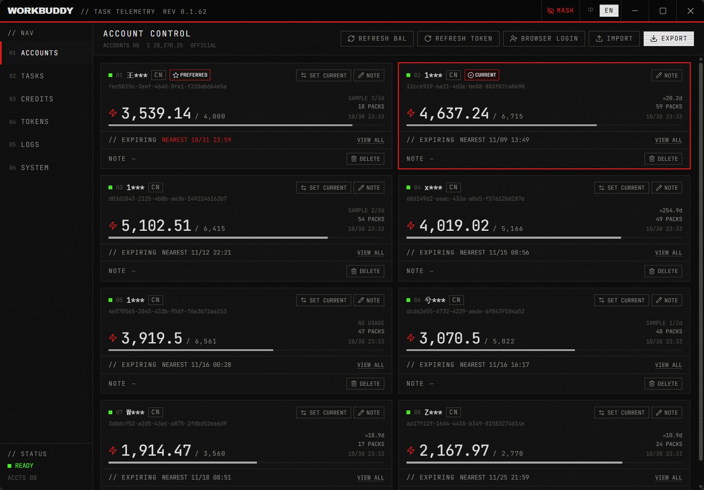
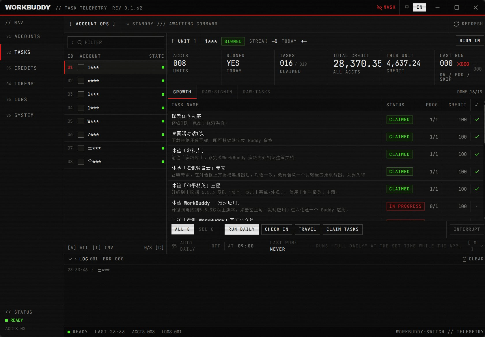
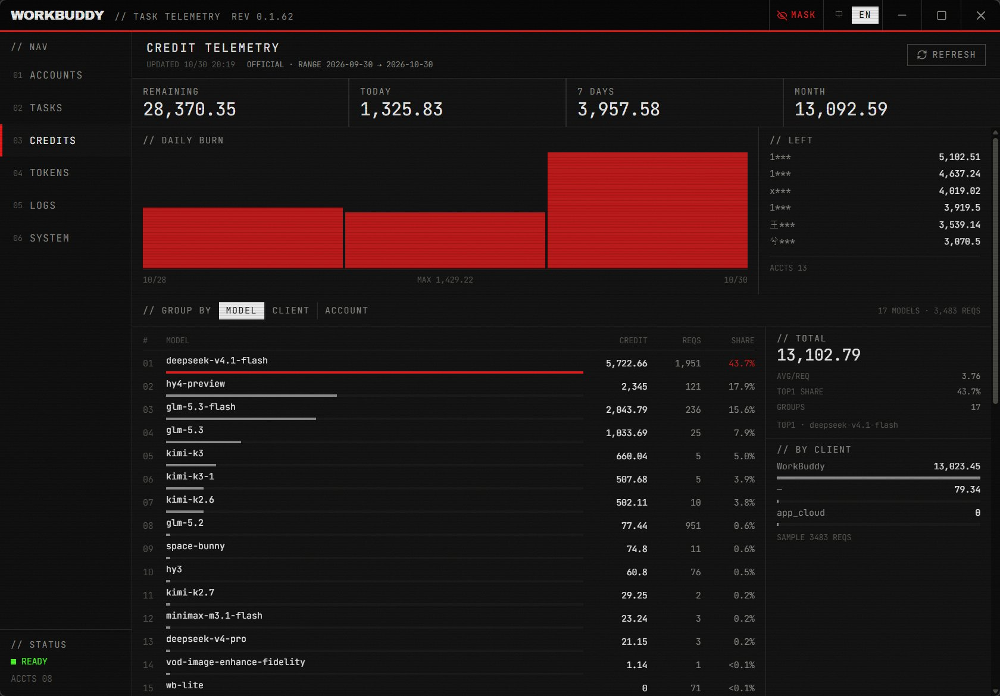
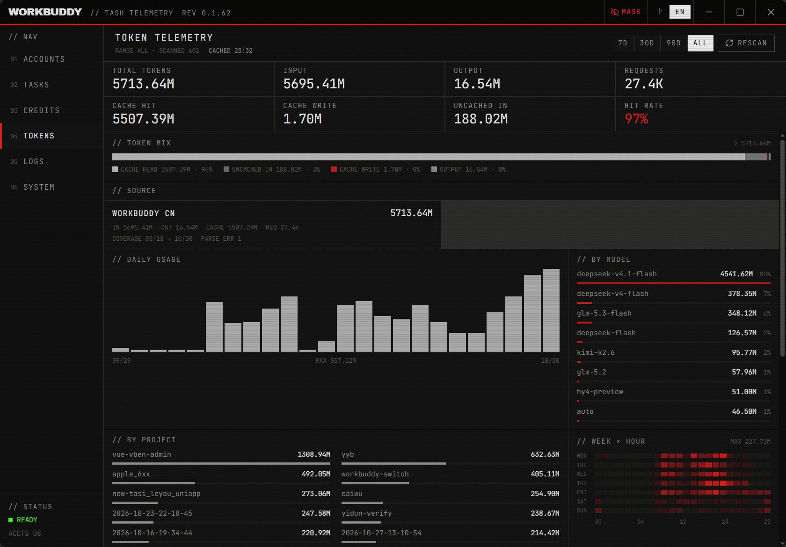
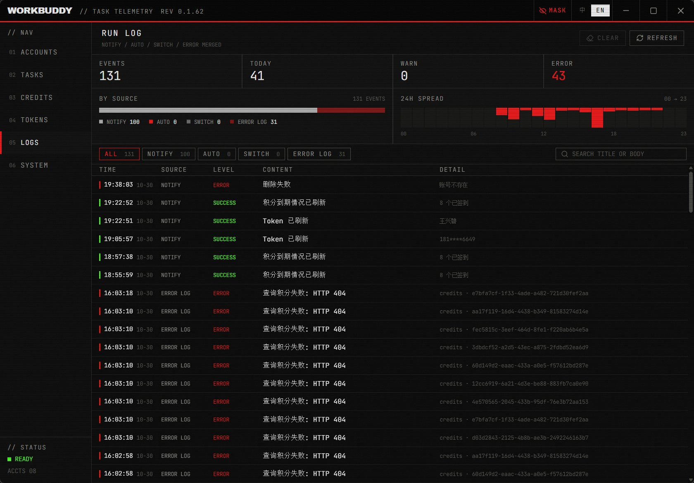
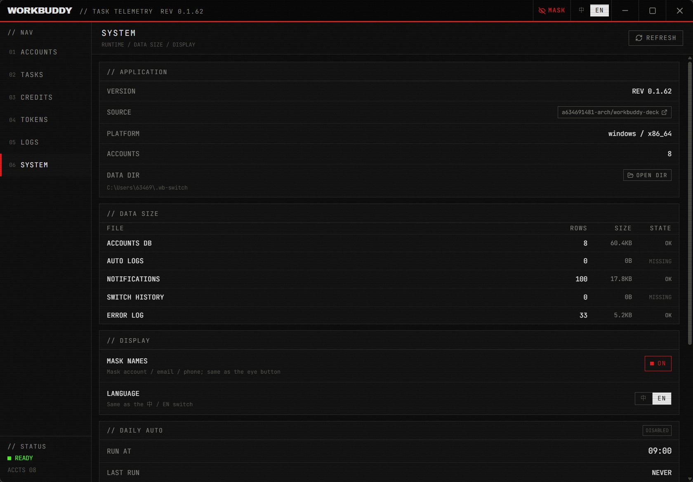

<!-- README_SYNC: source=working-tree; updated=2026-10-30 -->

<p align="center">
  <a href="./README_ZH.md">简体中文</a> · English
</p>

<h1 align="center">workbuddy-deck</h1>

<p align="center"><b>A control deck for multiple WorkBuddy accounts: switching, check-in, daily tasks, credits, tokens and rate limits on one screen.</b><br/>
Built for people running several WorkBuddy accounts who click through check-in and growth tasks by hand every day.</p>

<p align="center">
  If it saves you those ten minutes a day, a <a href="https://github.com/a634691481-arch/workbuddy-deck/stargazers"><b>star</b></a> helps you find it again — and helps the next person with the same chore find it too.
</p>

<p align="center">
  <a href="https://a634691481-arch.github.io/workbuddy-deck/"><b>Landing page</b></a> ·
  <a href="https://github.com/a634691481-arch/workbuddy-deck/releases/latest">Download</a>
</p>

<p align="center">
  <a href="https://github.com/a634691481-arch/workbuddy-deck/stargazers"></a>
  <a href="https://github.com/a634691481-arch/workbuddy-deck/issues"></a>
  <a href="https://github.com/a634691481-arch/workbuddy-deck/commits/main"></a>
  
  
  
  
</p>

<p align="center">
  
</p>

## The manual version, every day

Open the client → switch to account 1 → check in → claim growth rewards → switch to account 2 → repeat. Want to know how much credit is left today? Walk the whole list again.

At three accounts this is tolerable. At eight it is fifteen minutes of mechanical work — and **switching is the risky part**: if the session swap overwrites the previous account's records, what you lose is chat history, not a log line.

This app puts that loop in one desktop window: accounts run in sequence, results are grouped into success / failure / skipped, balances and expiries and rate limits sit on one screen, and every run leaves an archived record you can look up later.

## Six panes

| Pane | What it handles |
|---|---|
| 01 Accounts | QR login / import-export, balance and credit packages, **days-remaining forecast**, **health dot**, per-model rate limits, one-click "make current" |
| 02 Tasks | Pick accounts → check-in / growth / travel / full daily run, live progress and failure aggregation |
| 03 Credits | Daily spend, per-account balance, model / client / account breakdowns; official numbers first, local snapshots as fallback |
| 04 Tokens | Multi-source totals, top sessions, request detail, week × hour heatmap, **7-day comparison** |
| 05 Logs | Notification archive + daily runs + error log + **switch ledger**, four sources in one timeline, clearable per source |
| 06 Settings | Version, source link, data directory, data size, display prefs, **CSV export**, rate-limit auto-switch, per-source cleanup |

<p align="center">
  <br/>
  <sub>Task pane: accounts on the left, telemetry and task table in the middle, action bar at the bottom, log panel always visible</sub>
</p>

<p align="center">
  <br/>
  <sub>Credits: official usage when available, local snapshots as the fallback</sub>
</p>

<p align="center">
  <br/>
  <sub>Tokens: metrics → composition → sources → daily → projects → sessions / request detail</sub>
</p>

<p align="center">
  
  
</p>

## What is actually different

**1. Switching has a hard gate instead of "looks successful"**
Replace-mode sync must have *actually written* the data first: copied rows must equal source rows and failures must be zero before the target account's old sessions may be deleted. Otherwise it fails closed, keeps the old data, and says why in the result. This rule came from two real data-loss incidents (recorded in `tasks/lessons.md`) and has regression tests in the session module. After writing, the auth file is **read back and the uid verified**; a mismatch triggers a rollback.

**2. The balance line also tells you how long it lasts**
An account card no longer stops at `3,539 / 4,000`; it adds `≈21.0 days`. The estimate takes the smaller of a median and an EWMA (early warning beats optimism) and only counts **balance decreases** as usage — a check-in or reward that raises the balance is not negative consumption. With fewer than three days of snapshots it shows "sample 2/3 days" instead of inventing a number.

**3. Rate limits are attributed, not just reported**
Not "you got a 429", but which account, which model, the official reset time, and how many times it hit. It shows on the account card so you can pick an unrestricted account first — and there is an optional auto-switch (off by default, notify-only by default).

**4. Twenty accounts, one glance to find the dying one**
A health dot (green / grey / red) before each account name, from a deductive table you can read: rate-limited −35, zero balance −50, under 10% −30, fetch failure −20, forecast under 3 days −25, mostly-expiring credit −10. Hover shows the actual reasons; it is not a black-box score.

**5. The data leaves with you**
Four CSVs from Settings: accounts (with health and forecast), tokens by day, tokens by model (with share), and credit snapshots (with per-row deltas). UTF-8 with BOM, so Excel opens them without mojibake.

**6. It is still there when the window is closed**
The tray tooltip shows account count, total balance, and the tightest account's remaining days. Every run writes an archived notification that survives a restart and appears in pane 05.

## Quick start

**Install a build**: grab the latest `*_x64-setup.exe` from
[Releases](https://github.com/a634691481-arch/workbuddy-deck/releases). The in-app
"System → Updates" card picks up later versions automatically.

**Build from source**:

```bash
git clone https://github.com/a634691481-arch/workbuddy-deck.git
cd workbuddy-deck
npm install
npm run tauri build                  # NSIS installer + exe
npm run tauri build -- --no-bundle   # exe only, skips signing (fine for local work)
```

Installer: `src-tauri/target/release/bundle/nsis/`; raw exe: `src-tauri/target/release/workbuddy-task-assistant.exe`.
Requirements: Node.js 18+, stable Rust, Windows 10/11 with the WebView2 runtime.

The domain crate (accounts, check-in, growth tasks, travel, tokens, switching) is vendored at
`crates/wb-switch-core/`, so a fresh clone builds with no external path.

To work on the UI only (no data):

```bash
npx vite --port 1421
```

Open `http://localhost:1421/`; hashes jump straight to a pane: `#accounts` / `#tasks` / `#credits` / `#tokens` / `#logs` / `#settings`.

## Auto-update

Tag to running client is one closed loop with no manual upload step:

```
bump version  →  push tag  →  CI builds + signs  →  Release  →  client check  →  verify  →  install  →  restart
```

| Stage | How |
| --- | --- |
| Version | `npm run bump 0.1.1` writes `package.json` / `Cargo.toml` / `tauri.conf.json` at once; it refuses to run when the three already disagree |
| Release | `npm run bump 0.1.1 --tag`, or `git tag v0.1.1 && git push --tags` |
| Build | `.github/workflows/release.yml`: windows-latest → `tauri build --bundles nsis` → sign `.sig` + `latest.json` |
| Check | 8s after launch, then every 6h; manual check in Settings. Reads the release asset `latest.json`, **never the GitHub API** (60 req/h/IP) |
| Verify | A minisign mismatch aborts the install |
| Install | NSIS in `passive` mode overwrites in place and relaunches; the installer closes the old process |
| Trail | Result lands in the notification archive — visible in Logs as `更新 · v0.1.1 已下载并校验通过` |

**Mirror**: the Settings card accepts a prefix such as `https://ghproxy.net/`; both check and download go through it. Empty means direct GitHub.

**Where multiple versions come from**: one tag = one release = one set of installers. Publish `v0.1.1`
and it sits on top while `v0.1.0` stays downloadable; `releases/latest` always resolves to the newest
stable release, which is all the client looks at. Ship the next one with `npm run bump 0.1.1 --tag` —
never upload an exe by hand.

**One-time maintainer setup** (repo Settings → Secrets and variables → Actions):

| Secret | Value |
| --- | --- |
| `TAURI_SIGNING_PRIVATE_KEY` | the private key from `tauri signer generate` (**never commit it**) |
| `TAURI_SIGNING_PRIVATE_KEY_PASSWORD` | its passphrase |

Lose the key or passphrase and already-shipped clients can no longer auto-upgrade — they trust that one public key.

## Architecture

```text
frontend  src/components/ui/*      presentational atoms
          src/components/*         business components (props / emit only)
          src/composables/*        state and side effects (the only layer calling lib/api)
          src/views/*              six panes, each fetching and acting on its own
          src/lib/api.ts           the whole IPC contract (types + invoke wrappers)
backend   src-tauri/src/commands.rs thin command layer: validate then delegate
          src-tauri/src/executor.rs batch runner: mutex, progress snapshots, cancel, grouping
          src-tauri/src/scheduler.rs daily schedule: fire, receipt, run-on-miss
          src-tauri/src/export.rs  four CSV writers (BOM, escaping, write straight to disk)
          src-tauri/src/tray.rs    tray readout
          domain crate             accounts / check-in / growth / travel / tokens / switching / forecast / health
```

Design choices worth knowing:

- **One account at a time**, never parallel API calls; cancellation only lands on account boundaries so a single account's actions are never torn in half.
- **Mutex before queue**: one run at a time; a second trigger returns `busy` immediately.
- **Tokens never leave the backend**: returned account structures carry label / variant / note only; phone numbers and emails are masked in the UI and logs.
- **Forecasts read local snapshots only**: rate-limit and consumption decisions make no network calls, so a limited account does not have to wait for another round trip.
- **One accent colour** (aviation red); state is carried by 1px rules and monospaced numbers rather than gradients or rounded corners — telemetry styling that stays readable over long sessions.

## Data and privacy

- Everything stays in `~/.wb-switch/` on your machine (accounts, check-in config, notification archive, auto-run config, auto-switch config and logs, error log). Nothing is uploaded.
- The app reads and writes those local files and calls the official endpoints for check-in, tasks and token renewal. It does not proxy traffic, run a gateway, or export your conversations.
- The one outward-facing action is "make current": it closes WorkBuddy, replaces session files, writes the auth file and restarts. That is **destructive**, so it sits behind a confirmation with visible progress.
- Rate-limit auto-switch ships **off** and **notify-only**: actually switching closes and restarts WorkBuddy, which can lose unsaved work, so the app does not press that button for you by default.

## Known limitations

- Windows only (WebView2).
- Auto-update rides on GitHub Releases: direct access can be slow in some regions, so the Settings card takes a mirror prefix.
- No automated test pipeline beyond unit tests; type checking and clippy run locally via `npm run verify`, CI only builds releases.
- UI copy is Chinese-first. i18n with an English switch is built in, but English strings are still being filled in.
- The usage forecast needs at least three days of snapshots per account; on a fresh install it only shows sample progress.

## License

There is **no LICENSE file** in this repository, so no licence is granted here. Until one is added, assume "all rights reserved": reading and learning are fine, but ask in an issue before commercial use or redistribution. When a licence is chosen it will be added here and to the repository's About section together.

## Finally

If it saves you those minutes, a **star** is welcome. If a run fails, a check-in breaks, or a number looks wrong, open an [issue](https://github.com/a634691481-arch/workbuddy-deck/issues) with your account count, the action you ran, and the raw error — that is far more useful than "doesn't work".
