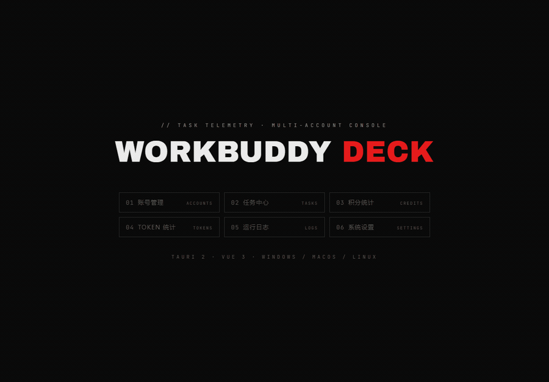

<!-- README_SYNC: source=working-tree; updated=2026-10-30 -->

<p align="center">
  简体中文 · <a href="./README_EN.md">English</a>
</p>

<h1 align="center">workbuddy-deck</h1>

<p align="center"><b>WorkBuddy 多账号控制台：切号、签到、日常任务、积分、TOKEN、限流，一块屏管完。</b><br/>
给同时养着好几个 WorkBuddy 账号、每天要手动点一遍签到和成长任务的人。</p>

<p align="center">
  如果它替你省下了每天那十几分钟，点个 <a href="https://github.com/a634691481-arch/workbuddy-deck/stargazers"><b>Star</b></a>：方便以后回来，也让更多同样在手动养号的人找到它。
</p>

<p align="center">
  <a href="https://a634691481-arch.github.io/workbuddy-deck/"><b>宣传页</b></a> ·
  <a href="https://github.com/a634691481-arch/workbuddy-deck/releases/latest">下载</a>
</p>

<p align="center">
  <a href="https://github.com/a634691481-arch/workbuddy-deck/stargazers"></a>
  <a href="https://github.com/a634691481-arch/workbuddy-deck/issues"></a>
  <a href="https://github.com/a634691481-arch/workbuddy-deck/commits/main"></a>
  
  
  
  
</p>

<p align="center">
  
</p>

## 不用它的时候，每天是这样的

打开客户端 → 逐个账号切换 → 签到 → 进成长中心领任务奖励 → 再切下一个 → 想确认今天额度还剩多少，得把账号再轮一遍。

三个账号还能忍，八个账号就是每天十几分钟的机械劳动。而且**切号本身就是风险点**：如果替换会话时上一个账号的记录被覆盖，丢的是聊天记录，不是日志。

这个应用把这段流程收进一个桌面窗口：串行跑完所有账号的签到与日常，结果按「成功 / 失败 / 跳过」归类；额度、到期、限流集中在一屏；每轮跑完写一条存档，事后能查。

## 七个分区

| 分区 | 解决的事 |
|---|---|
| 01 账号 | 扫码登录 / 导入导出、余额与积分包、**剩余天数预测**、**健康点**、模型限流标记、一键设为当前账号 |
| 02 任务 | 选账号 → 签到 / 成长任务 / 旅行，实时进度与失败聚合；**未完成的可展开看原因**，并一键拉起官方入口 |
| 03 积分 | 每日消耗、账号余额、模型 / 客户端 / 账号三维度，官方用量优先、本地快照兜底 |
| 04 TOKEN | 多数据源汇总、会话 TOP、调用明细、周 × 时热力图、**7 日环比** |
| 05 日志 | 通知存档 + 自动日常 + 错误日志 + **切换台账**四源合一，可按源清理 |
| 06 归档 | WorkBuddy 已归档任务的只读台账（条数 / 体积 / 归档时刻），可一键清理并自动关→清→拉起客户端 |
| 07 系统 | 版本、开源地址、数据目录、数据规模、显示偏好、**数据导出**、限流自动切换、按源清日志 |

## 真正不同的七点

**1. 切号有硬门槛，不是"看起来成功"**
替换式同步必须先**真实写入**：本次复制条数等于源会话数、且失败数为 0，才允许删除目标账号的旧会话；否则 fail-closed，保留旧数据并在结果里写明原因。这条规则来自两次真实的数据丢失事故，回归测试在核心 crate 的 session 模块。切换完成后还会**读回认证文件校验 uid**，身份不符直接回滚。

**2. 余额旁边写着"还能撑几天"**
账号卡不再只显示 `3,539 / 4,000`，而是附一个 `≈21.0 天`。算法用中位数与 EWMA 取小（宁可早预警），只把余额**下降**算作消耗——签到、领奖造成的上涨不是负消耗。样本不足 3 天时显示「样本 2/3 天」，而不是给一个猜出来的数字。

**3. 限流归因有台账**
不只告诉你"429 了"，而是记录**哪个账号、哪个模型、官方给的恢复时刻、命中几次**。账号卡上直接标出来，排班时先挑没被限的那个；需要的话可以打开限流自动切换（默认关闭，默认只提示不执行）。

**4. 20 个号也能一眼扫出"哪个快废了"**
每个账号名称前一个健康点（绿 / 灰 / 红），分数来自一张可解释的扣分表：限流 −35、余额为 0 −50、余额不足 10% −30、拉取失败 −20、预测 3 天内耗尽 −25、快到期额度占多数 −10。悬停能看到具体原因，不是黑盒评分。

**5. 数据能带走**
设置页可导出四份 CSV——账号（含健康分与预测）、Token 按天、Token 按模型（含占比）、积分快照（含逐条差值）。写 UTF-8 BOM，Excel 双击打开不乱码。

**6. 关掉窗口也还在**
托盘常驻，鼠标悬停就能看到「几个账号 · 合计余额 · 最紧的那个号还能撑几天」；每轮执行写一条通知存档，重启后仍在 05 分区按时间轴可查。

**7. 成长任务能自己跑完，跑不完也说清原因**
自动接取 → 补进度 → 达标即领奖，**已完成但没领的任务会在下一轮先补领**（曾有两个账号各卡住 200 分白丢）。剩下的没做任务不静默：任务页「未完成」可展开，逐账号列出任务名与原因（尝试次数用尽 / 需手动 / 无自动化），标「需手动」的带一键深链，点一下直接拉起客户端对应面板。每天定时跑一轮，手动跑过当天不再重复。

## 快速开始

**装现成的**：到 [Releases](https://github.com/a634691481-arch/workbuddy-deck/releases) 下最新的
`*_x64-setup.exe`，装完直接运行。应用内的「系统设置 → 自动更新」会自动发现后续版本。

**从源码构建**：

```bash
git clone https://github.com/a634691481-arch/workbuddy-deck.git
cd workbuddy-deck
npm install
npm run tauri build                  # NSIS 安装包 + exe
npm run tauri build -- --no-bundle   # 只出 exe，跳过签名（本地调试够用）
```

产物：安装包在 `src-tauri/target/release/bundle/nsis/`，裸 exe 在 `src-tauri/target/release/workbuddy-task-assistant.exe`。
前置条件：Node.js 18+、Rust stable、Windows 10/11（WebView2 运行时）。

领域能力 crate（账号库、签到、成长任务、旅行、令牌、切换）已随仓库放在 `crates/wb-switch-core/`，
克隆即可编译，不再需要外部路径。

只想调界面（无数据）可以跑浏览器预览：

```bash
npx vite --port 1421
```

打开 `http://localhost:1421/`，hash 可直达分区：`#accounts` / `#tasks` / `#credits` / `#tokens` / `#logs` / `#settings`。

## 自动更新

发版到客户端升级是一条闭环，中间没有手工上传步骤：

```
改版本号  →  打 tag  →  CI 构建+签名  →  Release  →  客户端检查  →  下载校验  →  覆盖安装  →  重启
```

| 段 | 做法 |
| --- | --- |
| 版本号 | `npm run bump 0.1.1` 一次同步 `package.json` / `Cargo.toml` / `tauri.conf.json`；三处本来不一致就直接报错退出 |
| 发版 | `npm run bump 0.1.1 --tag`（或手动 `git tag v0.1.1 && git push --tags`） |
| 构建 | `.github/workflows/release.yml`：windows-latest → `tauri build --bundles nsis` → 用私钥签出 `.sig` + `latest.json` |
| 检查 | 启动 8 秒后首查，之后每 6 小时；设置页可手动检查。读的是 release 资产 `latest.json`，**不走 GitHub API**（那有 60 次/小时/IP 限制） |
| 校验 | minisign 签名不匹配直接中止，不安装 |
| 安装 | NSIS `passive` 模式覆盖安装，装完自动重启；旧版本进程由安装器接管关闭 |
| 留痕 | 结果写入通知存档，日志页「通知存档」能看到 `更新 · v0.1.1 已下载并校验通过` |

**换源**：设置页「镜像前缀」可填 `https://ghproxy.net/` 一类前缀，检查与下载都走镜像；留空即直连 GitHub。

**多版本怎么来的**：一个 tag = 一个 Release = 一套安装包。`v0.1.1` 发布后，`Releases` 列表里
`v0.1.1` 在上、`v0.1.0` 仍可下载；`releases/latest` 始终指向最新正式版，客户端只认它。
要发下一版就是再跑一次 `npm run bump 0.1.1 --tag`，不要手工上传 exe。

**维护者一次性配置**（仓库 Settings → Secrets and variables → Actions）：

| Secret | 内容 |
| --- | --- |
| `TAURI_SIGNING_PRIVATE_KEY` | `tauri signer generate` 产出的私钥全文（**不入库**） |
| `TAURI_SIGNING_PRIVATE_KEY_PASSWORD` | 该私钥的口令 |

私钥或口令丢失后，已发布版本将无法再自动升级（客户端只认对应公钥），只能让用户手动装新包。

## 架构

```text
前端  src/components/ui/*      纯展示原子组件
      src/components/*         业务组件（只收 props / emit）
      src/composables/*        状态与副作用（唯一允许调用 lib/api 的层）
      src/views/*              六个分区，各自取数、各自处理动作
      src/lib/api.ts           全部 IPC 契约（类型 + invoke 封装）
后端  src-tauri/src/commands.rs 薄命令层：参数校验 + 转调
      src-tauri/src/executor.rs 批量执行器：互斥、进度快照、取消、结果归类
      src-tauri/src/scheduler.rs 每日定时：到点触发、写回执、错过补跑
      src-tauri/src/export.rs  四份 CSV 生成（BOM、转义、直写盘）
      src-tauri/src/tray.rs    托盘读数
      领域能力 crate            账号 / 签到 / 成长 / 旅行 / 令牌 / 切换 / 预测 / 健康分
```

关键取舍：

- **单账号串行执行**，不并发打接口；取消只在账号边界生效，保证单个账号的动作不被撕开。
- **互斥优先于排队**：同一时刻只允许一轮执行，重复触发直接返回 `busy`。
- **令牌永不出后端**：命令返回的账号结构只含 label / variant / note，界面与日志里手机号、邮箱统一脱敏。
- **预测只读本地快照**：限流与消耗相关的判断不发请求，被限流时不用再等一轮接口。
- **界面只有一个强调色**（航空红），状态靠 1px 实线与等宽数字区分，不用渐变和圆角——工业遥测风格，长时间盯不累。

## 数据与隐私

- 所有数据留在本机 `~/.wb-switch/`（账号库、签到配置、通知存档、自动日常配置、自动切换配置与日志、错误日志），不上传任何服务器。
- 应用只读写这些本地文件，并调用官方接口完成签到 / 任务 / 令牌续期；不代理、不建网关、不导出你的会话内容。
- 唯一的外部动作是「设为当前账号」：它会关闭 WorkBuddy、替换会话文件、写入认证并重启，属于**破坏性操作**，界面有二次确认与进度提示。
- 限流自动切换默认**关闭**且默认**只提示不执行**：自动执行会关闭并重启 WorkBuddy，正在编辑的内容可能丢失，所以默认不替你按下这个按钮。

## 已知限制

- **三平台都有安装包**：Windows NSIS、macOS dmg（Apple Silicon / Intel 各一份）、Linux AppImage + deb，CI 三平台各自构建。
- Windows 需要系统的 WebView2 运行时（Win11 自带；Win10 若缺失需装一次）。macOS / Linux 无需额外运行时。
- 客户端路径由程序探测（Windows 走进程 → 注册表 → 盘符扫描，macOS 用固定 `.app` 路径，Linux 用约定路径）。**换过安装目录的机器可能探测不到**，此时「设为当前账号 / 启动客户端」会失败，并在错误里列出尝试过的路径。
- 自动更新依赖 GitHub Releases：国内直连可能慢，需在设置里填镜像前缀。
- 尚无单元测试之外的自动化测试流水线；类型检查与 clippy 由本地 `npm run verify` 执行，CI 只负责构建发版。
- 界面文案中文为主，i18n 已内置中英切换，英文文案仍在补。
- 用量预测需要每个账号至少 3 天快照才会给出天数，新装当天只会显示样本进度。

## License

仓库当前**没有 LICENSE 文件**，因此这里不给出许可证承诺。在补充许可证之前，默认按「保留所有权利」处理：可以阅读、学习，但商业使用或再分发请先开 Issue 联系作者。选定协议后会在此处与仓库 About 同步更新。

## 最后

如果它替你省下了每天那十几分钟，欢迎点个 **Star**；遇到跑不通、签到失败或统计口径不对，直接开 [Issue](https://github.com/a634691481-arch/workbuddy-deck/issues) 带上账号数量、动作和错误原文，比"用不了"有用得多。
