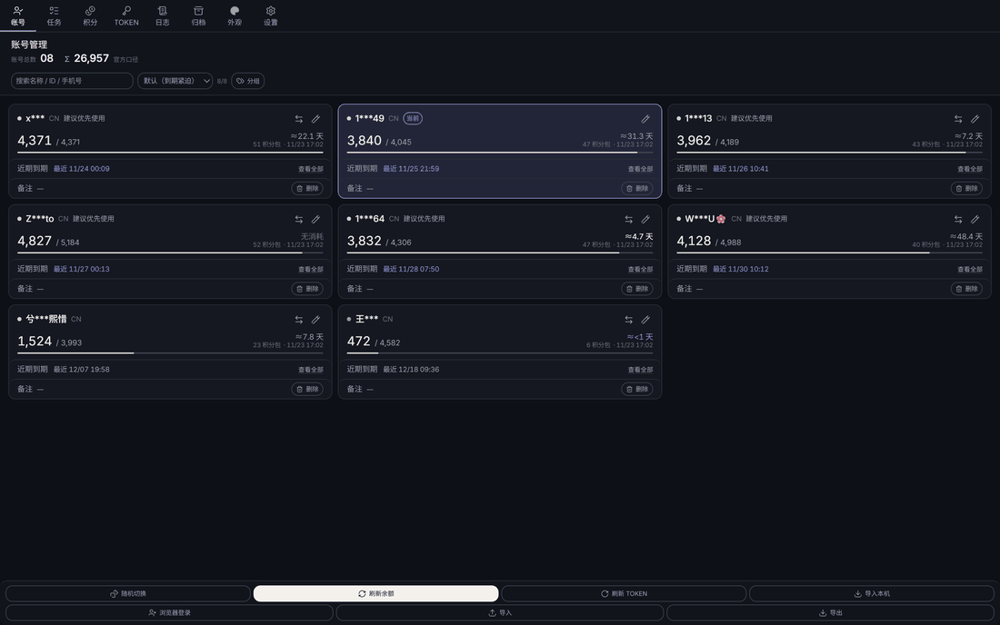

<!-- README_SYNC: source=working-tree; updated=2026-11-23 -->

<p align="center">
  简体中文 · <a href="./README_EN.md">English</a>
</p>

<h1 align="center">workbuddy-deck</h1>

<p align="center"><b>WorkBuddy 多账号控制台：注入在客户端里的悬浮面板，切号、签到、成长任务、积分、TOKEN、限流一块屏管完。</b><br/>
给同时养着好几个 WorkBuddy 账号、每天要手动点一遍签到和成长任务的人。</p>

<p align="center">
  如果它替你省下了每天那十几分钟，点个 <a href="https://github.com/a634691481-arch/workbuddy-deck/stargazers"><b>Star</b></a>：方便以后回来，也让更多同样在手动养号的人找到它。
</p>

<p align="center">
  <a href="https://a634691481-arch.github.io/workbuddy-deck/"><b>宣传页</b></a> ·
  <a href="https://github.com/a634691481-arch/workbuddy-deck/releases/latest"><b>下载</b></a>
</p>

<p align="center">
  <a href="https://github.com/a634691481-arch/workbuddy-deck/releases/latest"></a>
  <a href="https://github.com/a634691481-arch/workbuddy-deck/stargazers"></a>
  <a href="https://github.com/a634691481-arch/workbuddy-deck/issues"></a>
  <a href="https://github.com/a634691481-arch/workbuddy-deck/commits/main"></a>
  
  
  
  
</p>

<p align="center">
  
</p>

## 不用它的时候，每天是这样的

打开客户端 → 逐个账号切换 → 签到 → 进成长中心领任务奖励 → 再切下一个 → 想确认今天额度还剩多少，得把账号再轮一遍。

三个账号还能忍，八个账号就是每天十几分钟的机械劳动。而且**切号本身就是风险点**：如果替换会话时上一个账号的记录被覆盖，丢的是聊天记录，不是日志。

这个应用把这段流程收进一块控制台：串行跑完所有账号的签到与日常，结果按「成功 / 失败 / 跳过」归类；额度、到期、限流集中在一屏；每轮跑完写一条存档，事后能查。

## 两种形态，同一套功能

| 形态 | 怎么用 |
|---|---|
| **注入面板**（主力） | 双击 `WorkBuddy Deck.exe` → 校验官方客户端已安装 → 带 `--remote-debugging-port=9222` 拉起 WorkBuddy → CDP 连上后注入右下角悬浮图标 → 点图标在弹出的面板里操作，不离开客户端 |
| **独立窗口** | 同一个 exe 直接开桌面窗口，`Ctrl+K` 切分区；适合双屏或不想让面板挡着聊天区时用 |

安装包用 Inno Setup 打包，向导做两件事：扫注册表找到官方客户端路径（可手改）、检测客户端是否在运行（在跑就提示先关闭，确认后自动结束进程）。装完路径写进 `~/.wb-switch/workbuddy_exe.json`，运行时优先用它，不再靠猜。

## 六个分区

| 分区 | 解决的事 |
|---|---|
| 01 账号 | 扫码登录 / 导入导出、余额与积分包、剩余天数预测、健康点、模型限流标记、一键设为当前账号 |
| 02 任务 | 选账号 → 签到 / 成长任务 / 旅行 / 全套日常，实时进度与失败聚合 |
| 03 积分 | 每日消耗、账号余额、模型 / 客户端 / 账号三维度，官方用量优先、本地快照兜底 |
| 04 TOKEN | 多数据源汇总、会话 TOP、调用明细、周 × 时热力图、7 日环比 |
| 05 日志 | 通知存档 + 自动日常 + 错误日志 + 切换台账四源合一，可按源清理 |
| 06 系统 | 版本、数据目录、数据规模、显示偏好、数据导出、限流自动切换、按源清日志 |

## 真正不同的五点

**1. 切号不重启，也不动会话内容**
早期版本切号要关掉 WorkBuddy 再重启，现在默认热切换：只写认证文件 + 把当前会话池整体 `UPDATE user_id` 划归新账号。内容是同一批，只改归属，不复制、不删除；写完立刻做一次页面内身份探测，客户端没跟上就自动回退重启路径。最坏情况有整库备份（`~/.wb-switch/backups/reassign-preflight-*`）可回放。
`replace_sessions=true` 这条会物理删除目标账号会话的路已经在命令层禁死——它来自两次真实的数据丢失事故。

**2. 余额旁边写着「还能撑几天」**
账号卡不只显示 `3,539 / 4,000`，还附一个 `≈21.0 天`。算法用中位数与 EWMA 取小（宁可早预警），只把余额**下降**算消耗——签到、领奖造成的上涨不算负消耗。样本不足 3 天时显示「样本 2/3 天」，不猜数字。

**3. 限流归因有台账**
不只告诉你「429 了」，而是记录哪个账号、哪个模型、官方给的恢复时刻、命中几次。账号卡上直接标出来，排班时先挑没被限的；限流自动切换默认关闭且默认只提示不执行。

**4. 20 个号也能一眼扫出「哪个快废了」**
每个账号名称前一个健康点（绿 / 灰 / 红），分数来自可解释的扣分表：限流 −35、余额为 0 −50、余额不足 10% −30、拉取失败 −20、预测 3 天内耗尽 −25。悬停能看到具体原因，不是黑盒评分。

**5. 数据能带走，关掉窗口也还在**
设置页可导出四份 CSV（账号含健康分与预测、Token 按天、Token 按模型、积分快照），UTF-8 BOM，Excel 双击不乱码。托盘常驻，悬停看到「几个账号 · 合计余额 · 最紧的号还能撑几天」。

## 快速开始

**装现成的**：到 [Releases](https://github.com/a634691481-arch/workbuddy-deck/releases) 下最新的
`*_x64-setup.exe`（Windows）/ `*_aarch64.dmg`（macOS，Apple Silicon）/ `*.AppImage` 或 `*.deb`（Linux）。
应用内「系统设置 → 自动更新」会发现后续版本。

**从源码构建**：

```bash
git clone https://github.com/a634691481-arch/workbuddy-deck.git
cd workbuddy-deck
npm install
npm run tauri build
npm run installer
```

`tauri build` 出裸 exe + NSIS 安装包；`npm run installer` 可选，用 Inno Setup 再打一遍向导版（需先装 Inno Setup 6）。
产物：裸 exe 在 `src-tauri/target/release/workbuddy-task-assistant.exe`，NSIS 在 `bundle/nsis/`，Inno 在 `bundle/innosetup/`。
前置条件：Node.js 18+、Rust stable；Windows 10/11 需 WebView2，macOS / Linux 用系统 WebView。

**开发调试**（改前端热更新，无桌面窗口，只跑本地桥 + 注入）：

```bash
npm run deck
```

等于 `tauri dev -- --headless`。别同时开两个终端，端口预检会把先启动的那个收掉。

**只看界面**（无后端数据）：

```bash
npx vite --port 1421
```

打开 `http://localhost:1421/`，hash 直达分区：`#accounts` / `#tasks` / `#credits` / `#tokens` / `#logs` / `#settings`。

## 注入是怎么接上的

```text
启动器校验官方客户端（注册表 / 默认目录）
   → 未运行：带 --remote-debugging-port=9222 拉起
   → 已在跑：提示先关闭，确认后结束进程再带参拉起
本地桥起在 127.0.0.1:17653（面板前端 + IPC 全在这里）
CDP 连 9222 上的 WorkBuddy 页面 → 注册新文档自动注入 → 立即注入一次
右下角出现机器人图标；之后每 5 秒探活，页面导航把图标清掉就重注入
点图标 → 页面内弹出 iframe 面板 → 加载 17653 → 完整 UI
```

没有调试端口就注入不了，所以「启动器」和「注入器」是同一个 exe 的两段职责。

## 自动更新

```text
改版本号  →  打 tag  →  CI 构建+签名  →  Release  →  客户端检查  →  下载校验  →  覆盖安装  →  重启
```

| 段 | 做法 |
| --- | --- |
| 版本号 | `npm run bump 0.1.28` 一次同步 `package.json` / `Cargo.toml` / `tauri.conf.json`，不一致直接报错 |
| 构建 | `.github/workflows/release.yml`：三平台并行 `tauri build`，私钥签出 `.sig` + `latest.json` |
| 检查 | 启动后首查，之后定时轮询；读 release 资产 `latest.json`，不走 GitHub API |
| 校验 | minisign 签名不匹配直接中止，不安装 |
| 换源 | 设置页「镜像前缀」可填 `https://ghproxy.net/` 一类，留空即直连 |

## 架构

```text
前端  src/components/ui/*      纯展示原子组件
      src/components/*         业务组件（只收 props / emit）
      src/composables/*        状态与副作用（唯一允许调用 lib/api 的层）
      src/views/*              六个分区，各自取数、各自处理动作
      src/lib/api.ts           全部 IPC 契约（类型 + invoke 封装）
后端  src-tauri/src/commands.rs 薄命令层：参数校验 + 转调
      src-tauri/src/launcher.rs 启动器前置校验（只 Windows 生效）
      src-tauri/src/deck_http/* 本地桥：静态资源 + IPC + 面板 token
      src-tauri/src/executor.rs 批量执行器：互斥、进度快照、取消、结果归类
      src-tauri/src/scheduler.rs 每日定时：到点触发、写回执、错过补跑
      src-tauri/src/export.rs  四份 CSV 生成
      领域 crate wb-switch-core 账号 / 签到 / 成长 / 旅行 / 令牌 / 切换 / 预测 / 健康分 / CDP 注入
```

关键取舍：

- **单账号串行执行**，不并发打接口；取消只在账号边界生效。
- **互斥优先于排队**：同一时刻只允许一轮，重复触发直接返回 `busy`。
- **令牌永不出后端**：界面与日志里的手机号、邮箱统一脱敏。
- **预测只读本地快照**：限流与消耗判断不发请求。

## 数据与隐私

- 所有数据留在本机 `~/.wb-switch/`（账号库、签到与自动化配置、通知存档、切换历史、备份），不上传任何服务器。
- 只读写本地文件 + 调用官方接口完成签到 / 任务 / 令牌续期；不代理、不建网关、不导出会话内容。
- 唯一的外部动作是「设为当前账号」：改写认证文件并把会话池划归新账号，属于破坏性操作，界面有二次确认、进度提示与整库备份。

## 已知限制

- 注入依赖客户端调试端口：官方客户端更新若改了启动参数或页面结构，注入可能失效，需要跟版本修。
- 三平台发版，但 macOS 只发 Apple Silicon；包用 ad-hoc 签名（未公证），首次打开要到「隐私与安全性」点「仍要打开」，若提示已损坏执行 `sudo xattr -cr "/Applications/WorkBuddy Deck.app"`。
- 自动更新依赖 GitHub Releases，国内直连可能慢，需填镜像前缀。
- 核心 crate 有 879 个单测、命令层 46 个，`npm run verify` 跑类型检查与 clippy；CI 只负责构建发版。
- 界面中文为主，i18n 内置中英切换，英文文案仍在补。
- 用量预测需要每个账号至少 3 天快照，新装当天只显示样本进度。

## License

仓库当前**没有 LICENSE 文件**，因此这里不给出许可证承诺。在补充许可证之前，默认按「保留所有权利」处理：可以阅读、学习，但商业使用或再分发请先开 Issue 联系作者。

## 最后

如果它替你省下了每天那十几分钟，欢迎点个 **Star**；遇到跑不通、签到失败或统计口径不对，直接开 [Issue](https://github.com/a634691481-arch/workbuddy-deck/issues) 带上账号数量、动作和错误原文，比「用不了」有用得多。
