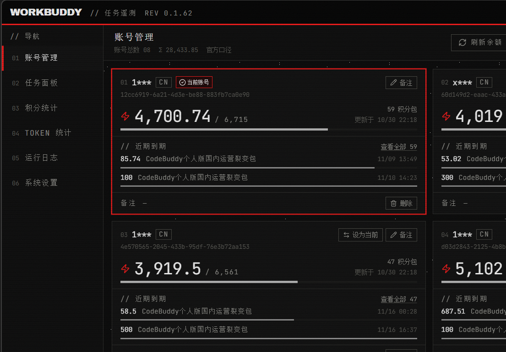
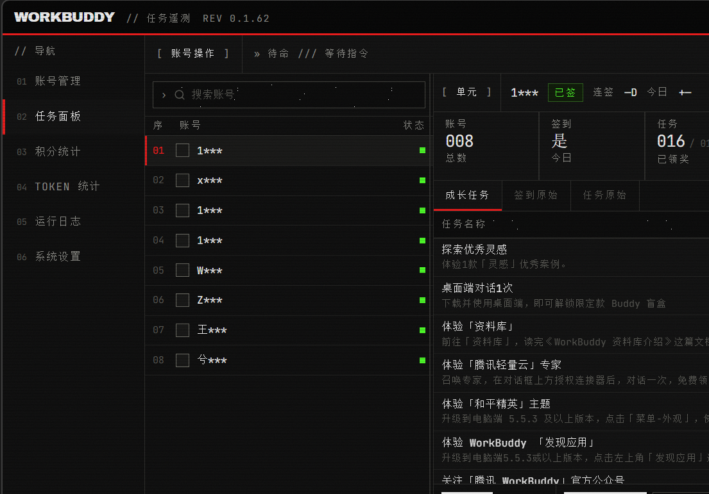
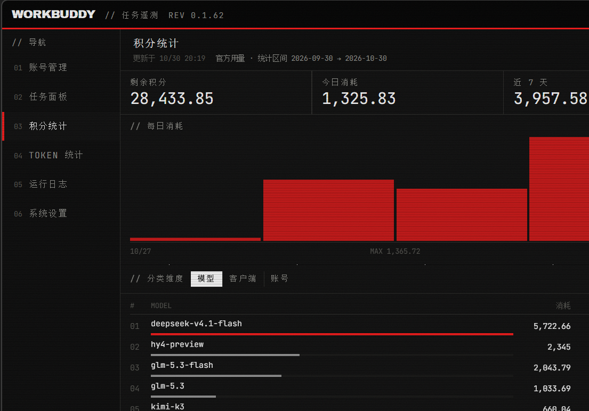
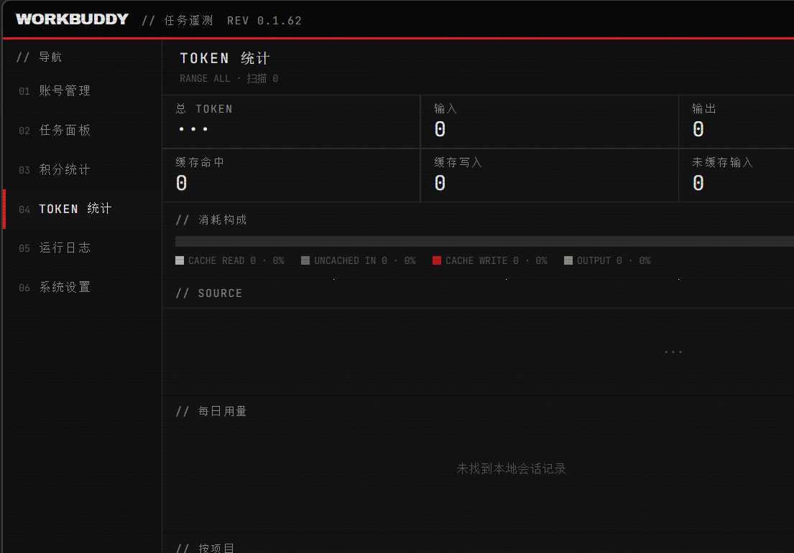
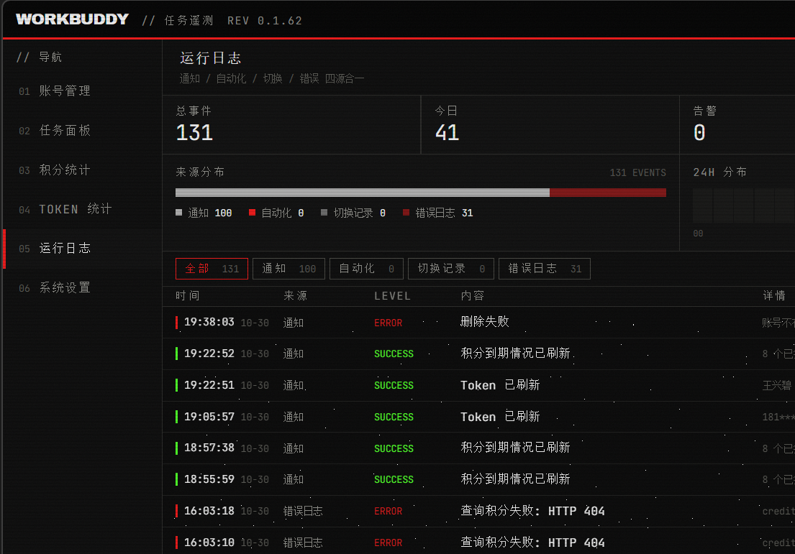
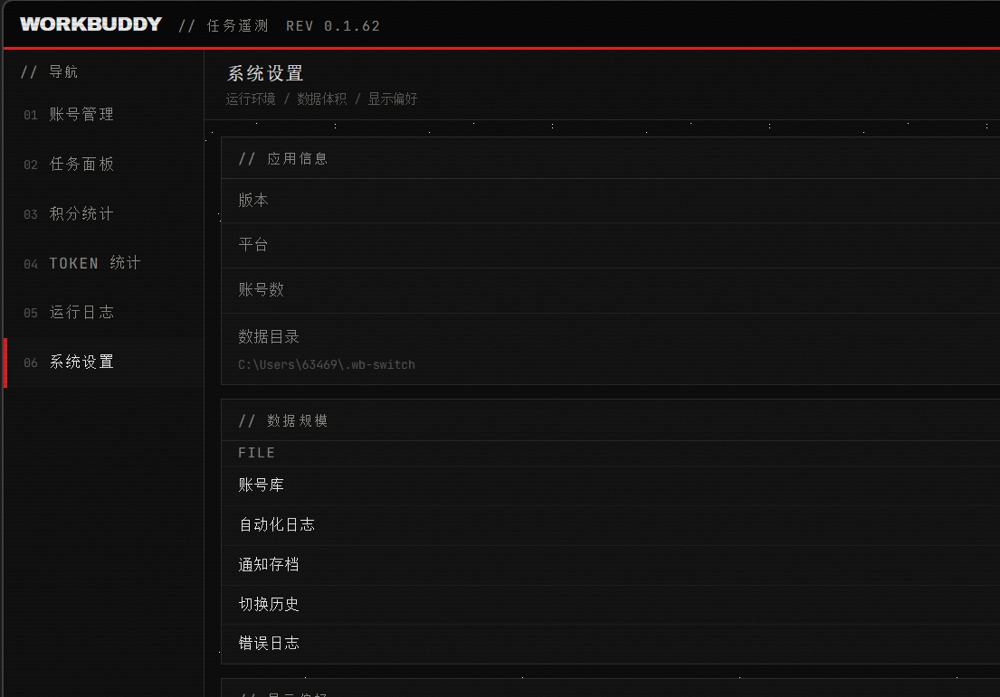

<!-- README_SYNC: source=working-tree; updated=2026-10-30 -->

<p align="center">
  简体中文 · <a href="./README_EN.md">English</a>
</p>

<h1 align="center">workbuddy-deck</h1>

<p align="center"><b>WorkBuddy 多账号运营控制台：切号、签到、日常任务、积分、TOKEN、日志，一屏管完。</b><br/>
面向同时养着多个 WorkBuddy 账号、每天要手动点一遍签到和成长任务的人。</p>

<p align="center">
  如果这个项目解决了你的实际问题，点一个 <a href="https://github.com/a634691481-arch/workbuddy-deck/stargazers"><b>Star</b></a>：方便以后回来，也让更多同样在手动养号的人找到它。
</p>

<p align="center">
  <a href="https://github.com/a634691481-arch/workbuddy-deck/stargazers"></a>
  <a href="https://github.com/a634691481-arch/workbuddy-deck/issues"></a>
  <a href="https://github.com/a634691481-arch/workbuddy-deck/commits/main"></a>
  
  
  
  
</p>

<p align="center">
  
</p>

## 不用它的时候，每天是这样的

打开客户端 → 逐个账号切换 → 签到 → 进成长中心领任务奖励 → 再切下一个 → 想确认今天额度还剩多少，得把账号再轮一遍。

这套动作在 3 个账号上还能忍，8 个账号就是每天十几分钟的机械劳动，而且**切换本身就是风险点**：如果切号时把上一个账号的会话覆盖掉，丢的是聊天记录，不是日志。

这个应用把这段流程收进一个桌面窗口：串行跑完所有账号的签到与日常，结果按「成功 / 失败 / 跳过」归类；账号额度、积分包到期、模型限流集中在一屏；跑完写一条通知存档，事后能查。

## 六个分区

| 分区 | 解决的事 |
|---|---|
| 01 账号 | 扫码登录 / 导入导出、余额与积分包、到期提醒、模型限流标记、一键设为当前账号 |
| 02 任务 | 选账号 → 签到 / 成长任务 / 旅行 / 全套日常，实时进度与失败聚合 |
| 03 积分 | 每日消耗、账号余额、模型 / 客户端 / 账号三维度，官方用量优先、本地快照兜底 |
| 04 TOKEN | 多数据源汇总、会话 TOP、调用明细、周 × 时热力图 |
| 05 日志 | 通知存档 + 自动日常 + 错误日志三源合一，可按源清理 |
| 06 系统 | 版本、数据目录、数据规模、显示偏好、定时任务摘要、按源清日志 |

<p align="center">
  <br/>
  <sub>任务面板：左侧账号勾选，中间遥测读数与任务表，底部操作条，日志面板常驻</sub>
</p>

<p align="center">
  <br/>
  <sub>积分统计：官方用量可用时优先官方口径，不可用时回退本地快照</sub>
</p>

<p align="center">
  <br/>
  <sub>TOKEN 统计：指标 → 构成 → 数据源 → 每日 → 项目分布 → 会话 / 调用明细</sub>
</p>

<p align="center">
  
  
</p>

## 真正不同的四点

1. **切号有硬门槛，不是"看起来成功"**
   替换式同步必须先**真实写入**：本次复制条数等于源会话数、且失败数为 0，才允许删除目标账号的旧会话；否则 fail-closed，保留旧数据并在结果里说明原因。这条规则来自两次真实的数据丢失事故，过程记录在 `tasks/lessons.md`，回归测试在 `wb-switch-core` 的 session 模块。

2. **限流归因有台账**
   不只告诉你"429 了"，而是记录**哪个账号、哪个模型、官方给的恢复时刻**，账号卡上直接标出来，排班时先挑没被限的那个。

3. **跑完不会失忆**
   每轮执行结束写一条通知存档（`notifications.json`），和自动日常日志、错误日志一起在 05 分区按时间轴呈现。关掉窗口、重启应用都还在。

4. **离线也能看**
   账号卡先读本地快照秒开，官方资源包在后台补齐；官方失败不回滚本地结果——断网时你至少知道上次的余额。

## 快速开始

目前只发布源码，成品安装包在 Release 页面跟进中。

```bash
git clone https://github.com/a634691481-arch/workbuddy-deck.git
cd workbuddy-deck
npm install
npm run tauri build -- --no-bundle
```

产物在 `src-tauri/target/release/workbuddy-task-assistant.exe`。前置条件：Node.js 18+、Rust 工具链（stable）、Windows 10/11（WebView2 运行时）。

> ⚠️ **构建依赖尚未随仓库发布**：`src-tauri/Cargo.toml` 用 `path` 引用 `wb-switch-core`（账号库、签到、成长任务、旅行、令牌、切换的实现）。当前克隆后需自行提供该 crate 才能编译。正在整理独立发布的方案，这也是本仓库唯一的硬性构建门槛。

只想调界面（无数据）可以跑浏览器预览：

```bash
npx vite --port 1421
```

打开 `http://localhost:1421/`，hash 可直达分区：`#accounts` / `#tasks` / `#credits` / `#tokens` / `#logs` / `#settings`。

## 架构

```text
前端  src/components/ui/*      纯展示原子组件
      src/components/*         业务组件（只收 props / emit）
      src/composables/*        状态与副作用（唯一允许调用 lib/api 的层）
      src/views/*              六个分区，各自取数、各自处理动作
      src/lib/api.ts           全部 IPC 契约（类型 + invoke 封装）
后端  src-tauri/src/commands.rs 薄命令层：参数校验 + 转调
      src-tauri/src/executor.rs 批量执行器：互斥、进度快照、取消、结果归类
      src-tauri/src/scheduler.rs 每日定时：到点触发、写回执、错过补跑
      wb-switch-core           领域能力（账号 / 签到 / 成长 / 旅行 / 令牌 / 切换）
```

关键取舍：

- **单账号串行执行**，不并发打接口；取消只在账号边界生效，保证单个账号的动作不被撕开。
- **互斥优先于排队**：同一时刻只允许一轮执行，重复触发直接返回 `busy`。
- **令牌永不出后端**：命令返回的账号结构只含 label / variant / note，界面与日志里手机号、邮箱统一脱敏。
- **界面只有一个强调色**（航空红），状态靠 1px 实线与等宽数字区分，不用渐变和圆角——工业遥测风格，长时间盯不累。

## 数据与隐私

- 所有数据留在本机 `~/.wb-switch/`（账号库、签到配置、通知存档、自动日常配置、错误日志），不上传任何服务器。
- 应用只读写这些本地文件，并调用官方接口完成签到 / 任务 / 令牌续期；不代理、不建网关、不导出你的会话内容。
- 唯一的外部动作是「设为当前账号」：它会关闭 WorkBuddy、替换会话文件、写入认证并重启，属于**破坏性操作**，界面有二次确认与进度提示。

## 与 workbuddy-switch 的关系

本项目不是从零开始：领域能力来自 [`workbuddy-switch`](https://github.com/changexbc/workbuddy-switch)（账号切换 / 签到 / 积分统计）。在此基础上重写了桌面端：

- 六分区控制台布局与工业遥测视觉体系；
- 批量执行器（进度快照、取消、结果归类、通知存档闭环）；
- 修复替换式切号「复制未真实完成仍删除旧会话」的数据丢失缺陷，并加了回归测试与 fail-closed 门槛；
- 新增账号卡片流、限流归因标记、积分 / TOKEN 多维度统计、运行日志三源合一、系统设置与托盘常驻。

如果你只需要命令行式的切换与签到，上游项目更轻；如果你每天要在多账号之间来回，这里是把它做成了一块仪表盘。

## 已知限制

- 仅 Windows（依赖 WebView2）。
- 无自动更新，升级靠重新构建或替换 exe。
- `wb-switch-core` 未随仓库发布，源码构建需要自行提供（见上）。
- 尚无 CI 与自动化测试流水线；前端类型检查与 clippy 通过本地 `npm run verify` 执行。
- 界面文案中文为主，i18n 已内置中英切换，但英文文案仍在补。

## License

仓库当前**没有 LICENSE 文件**，因此这里不给出许可证承诺。在补充许可证之前，默认按「保留所有权利」处理：可以阅读、学习，但商业使用或再分发请先开 Issue 联系作者。选定协议后会在此处与仓库 About 同步更新。

## 最后

如果它替你省下了每天那十几分钟，欢迎点个 **Star**；遇到跑不通、签到失败或统计口径不对，直接开 [Issue](https://github.com/a634691481-arch/workbuddy-deck/issues) 带上账号数量、动作和错误原文，比"用不了"有用得多。
