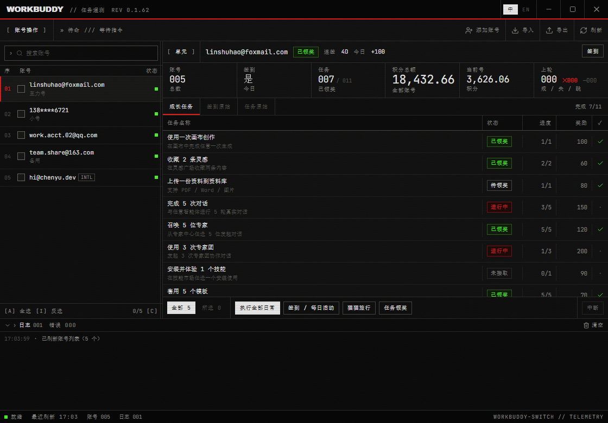

# workbuddy-deck

**WorkBuddy 多账号运营控制台** —— 账号 / 日常任务 / 积分 / TOKEN / 运行日志，一屏管完。



> 桌面端（Windows），Tauri 2 + Rust + Vue 3 + Tailwind v4。工业遥测风格界面，深色 CRT 质感。

## 特性

- **账号管理**：浏览器扫码登录、导入 / 导出、备注、余额与积分包明细、到期提醒（「建议优先使用」）、模型限流归因
- **安全切号**：完全同步模式（备份 → 替换会话 → 写认证 → 重启），**复制全部成功才允许删除旧会话**，部分失败直接 fail-closed
- **批量任务**：签到 / 成长任务 / 旅行 / 全套日常，单号失败不中断整轮，支持随时中断；进度条 + 分类计数（成功 / 失败 / 跳过）
- **自动日常**：每日定时执行，错过整点醒来补跑；与手动执行互斥（busy 不排队）
- **积分统计**：官方用量优先，本地快照兜底；每日柱图 + 模型 / 客户端 / 账号多维度
- **TOKEN 统计**：多数据源汇总、会话 TOP、调用明细、周 × 时热力图
- **运行日志**：通知存档 + 自动日常日志 + 错误日志三源合一，可按源清理
- **系统托盘**：关窗常驻托盘，托盘直达签到 / 日常

## 与 [workbuddy-switch](https://github.com/changexbc/workbuddy-switch) 的关系

本项目源自 `workbuddy-switch`（账号切换 + 签到 + 统计），在其核心能力（`wb-switch-core`）之上重写了整个桌面端：

- 新增 6 分区控制台布局（账号 / 任务 / 积分 / TOKEN / 日志 / 系统）
- 修复了切号时「目标账号会话被清空」的数据丢失缺陷（复制计数含 `alreadyLinked` 导致误删）
- 批量执行器重写：进度快照、取消、结果归类、通知存档闭环

## 从源码构建

```bash
npm install
npm run tauri build
```

> ⚠️ 当前 `wb-switch-core` 以本地 path 依赖引入（`../../workbuddy-switch/crates/wb-switch-core`），尚未随本仓库发布。独立构建方案在整理中，请先关注 Release 页面获取成品。

## 目录结构

```
src/            Vue 3 前端（views 自闭环，composables 统一走 lib/api.ts）
src-tauri/      Rust 后端（commands 薄命令层 + executor 批量执行器 + scheduler 定时）
assets/         应用图标
docs/           截图与文档
tasks/          开发过程记录（todo / lessons / 体验评审）
```

## License

待定（发布前补充）。
