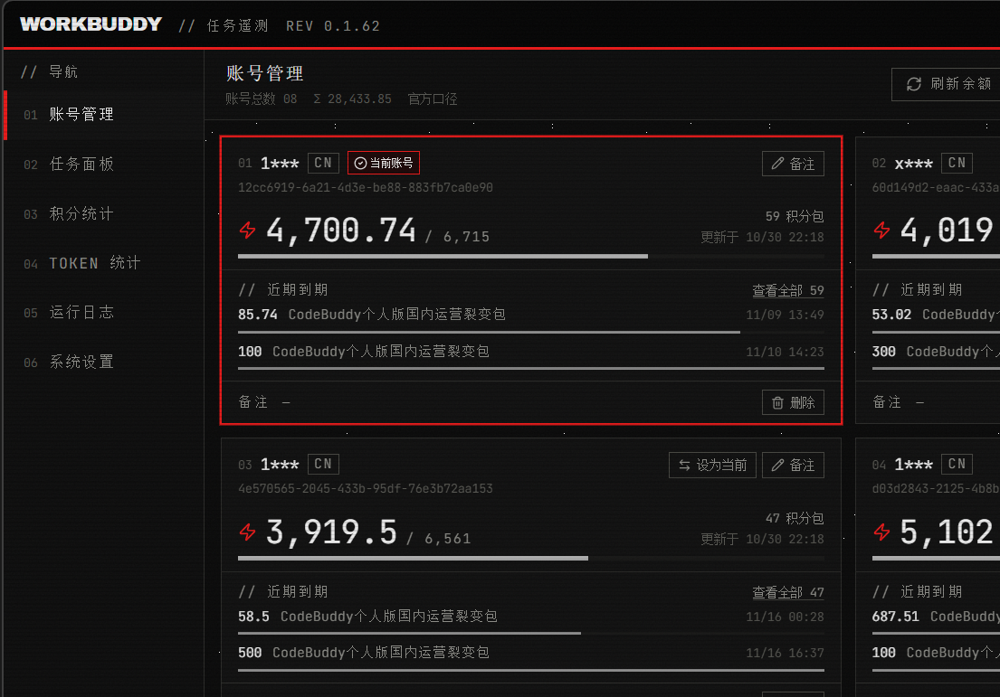
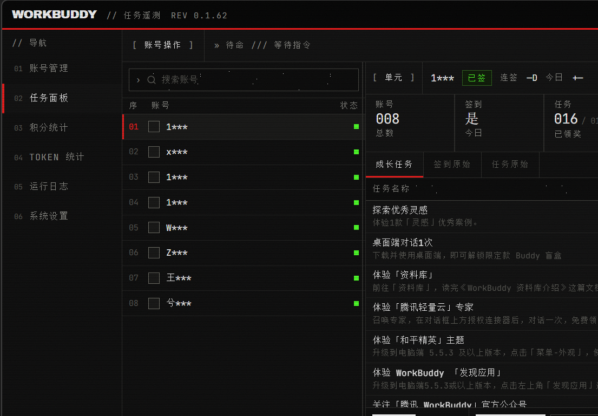
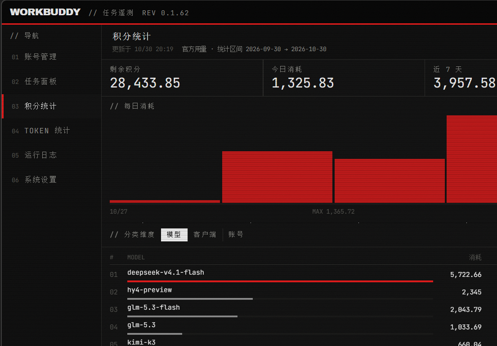
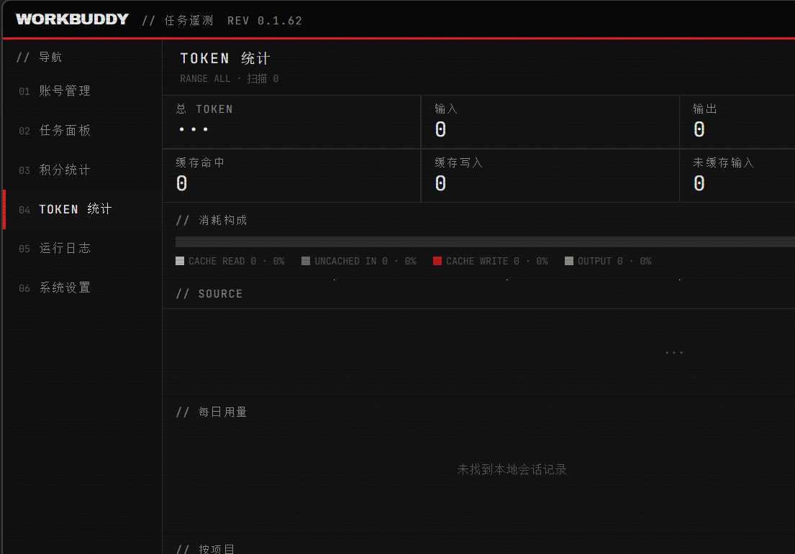
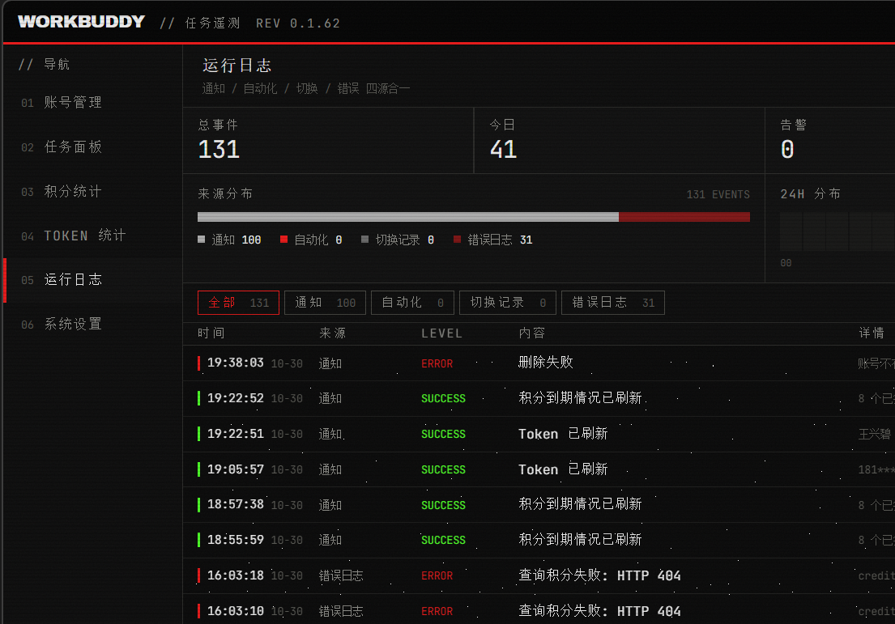
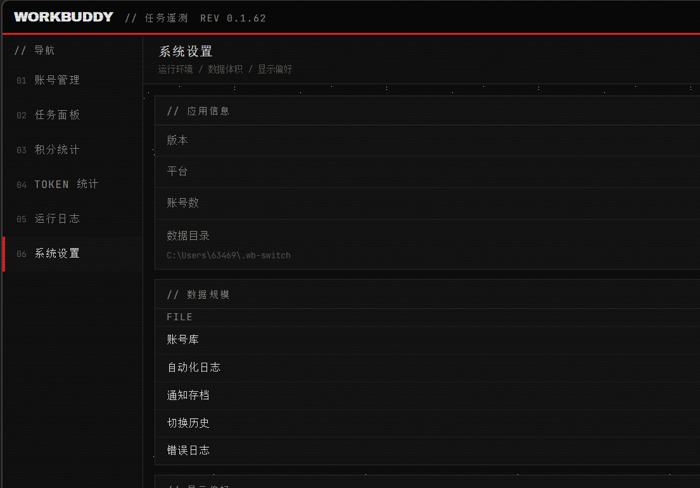

<!-- README_SYNC: source=working-tree; updated=2026-10-30 -->

<p align="center">
  <a href="./README.md">简体中文</a> · English
</p>

<h1 align="center">workbuddy-deck</h1>

<p align="center"><b>A desktop control deck for running multiple WorkBuddy accounts: account switching, daily check-in, growth tasks, credits, token usage and logs in one screen.</b><br/>
Built for people who keep several WorkBuddy accounts alive and click through check-in plus growth rewards by hand every day.</p>

<p align="center">
  If this saves you the daily clicking, consider a <a href="https://github.com/a634691481-arch/workbuddy-deck/stargazers"><b>star</b></a> — it keeps the project findable for others with the same chore.
</p>

<p align="center">
  <a href="https://github.com/a634691481-arch/workbuddy-deck/stargazers"></a>
  <a href="https://github.com/a634691481-arch/workbuddy-deck/issues"></a>
  <a href="https://github.com/a634691481-arch/workbuddy-deck/commits/main"></a>
  
  
  
  
</p>

<p align="center">
  
</p>

## The daily chore it replaces

Open the client → switch account → check in → open the growth center for rewards → switch back → repeat for every account → then hunt through each account again just to see how much quota is left.

Tolerable with three accounts. With eight it is ten-plus minutes of mechanical clicking — and **switching itself is the risky part**: if a switch replaces the wrong session set, you lose chat history, not a log line.

This app folds that loop into one desktop window: check-in and daily tasks run serially across all accounts with results classified as success / failed / skipped; quota, credit-package expiry and model rate limits sit on one screen; every run writes a notification record you can look up later.

## Six sections

| Section | What it is for |
|---|---|
| 01 Accounts | QR login, import/export, balances and credit packages, expiry reminders, rate-limit markers, set-as-current |
| 02 Tasks | Pick accounts → check-in / growth / travel / full daily run, live progress and failure rollup |
| 03 Credits | Daily spend, per-account balances, model / client / account breakdowns; official usage first, local snapshot fallback |
| 04 Tokens | Multi-source totals, top sessions, per-call detail, week × hour heatmap |
| 05 Logs | Notification archive + auto-daily log + error log merged on one timeline, clearable per source |
| 06 Settings | Version, data directory, data size, display preferences, schedule summary, per-source log cleanup |

<p align="center">
  <br/>
  <sub>Task panel: account selection on the left, telemetry readouts and task table in the middle, log panel always visible</sub>
</p>

<p align="center">
  
  
</p>

<p align="center">
  
  
</p>

## What is actually different

1. **Switching is gated on real writes, not on "it looks fine"**
   A replace-style sync must genuinely copy everything first: copied count equals source session count and failures equal zero, only then is the target account's old session set deleted. Otherwise the operation fails closed, keeps the old data, and explains why in the result. The rule came out of two real data-loss incidents documented in `tasks/lessons.md`, with regression tests in the `wb-switch-core` session module.

2. **Rate limits get a ledger**
   Not just "429 happened": it records which account, which model, and the reset time reported by the service, then surfaces that on the account card so you schedule around the free one.

3. **Runs are not forgotten**
   Every run writes a notification record (`notifications.json`), merged with the auto-daily log and error log into one timeline. Close the window, restart the app — it is still there.

4. **Works offline**
   Account cards read a local snapshot first (instant paint), official credit packages fill in afterwards; a failed official call never rolls back local numbers. Offline, you still know yesterday's balance.

## Quick start

Source only for now; a packaged build is planned for Releases.

```bash
git clone https://github.com/a634691481-arch/workbuddy-deck.git
cd workbuddy-deck
npm install
npm run tauri build -- --no-bundle
```

The binary lands in `src-tauri/target/release/workbuddy-task-assistant.exe`. Prerequisites: Node.js 18+, a stable Rust toolchain, Windows 10/11 with the WebView2 runtime.

> ⚠️ **One build dependency is not published yet**: `src-tauri/Cargo.toml` references `wb-switch-core` via a `path` dependency (accounts, check-in, growth tasks, travel, tokens, switching). A fresh clone needs that crate supplied locally before it compiles. Publishing it separately is in progress — this is currently the only hard build blocker.

UI-only preview (no data, no IPC):

```bash
npx vite --port 1421
```

Open `http://localhost:1421/`; hash deep links: `#accounts` / `#tasks` / `#credits` / `#tokens` / `#logs` / `#settings`.

## Architecture

```text
frontend  src/components/ui/*      presentational atoms
          src/components/*         feature components (props / emit only)
          src/composables/*        state and side effects (the only layer allowed to call lib/api)
          src/views/*              six sections, each owning its data and actions
          src/lib/api.ts           the entire IPC contract (types + invoke wrappers)
backend   src-tauri/src/commands.rs  thin command layer: validate + delegate
          src-tauri/src/executor.rs  batch runner: mutex, progress snapshot, cancel, result classification
          src-tauri/src/scheduler.rs daily timer: fire on time, write receipt, catch up if missed
          wb-switch-core           domain logic (accounts / check-in / growth / travel / tokens / switching)
```

Design decisions worth knowing:

- **One account at a time**, no parallel API calls; cancellation applies at account boundaries so a single account's step is never torn apart.
- **Mutex over queue**: only one run at a time, a duplicate trigger returns `busy` instead of piling up.
- **Tokens never leave the backend**: command payloads carry label / variant / note only; phone numbers and emails are masked in UI and logs.
- **A single accent color** (aviation red), separation by 1px rules and monospaced digits — telemetry styling, no gradients, no rounded corners.

## Data and privacy

- Everything stays on your machine under `~/.wb-switch/` (account store, check-in config, notification archive, auto-daily config, error log). Nothing is uploaded.
- The app only reads and writes those local files and calls the official endpoints for check-in / tasks / token refresh. It is not a proxy or a gateway, and it does not export your conversations.
- The one destructive action is "set as current account": it closes WorkBuddy, replaces session files, writes credentials and restarts the app. It is behind an explicit confirmation with progress reporting.

## Relationship to workbuddy-switch

This is not a from-scratch project. Domain capabilities come from [`workbuddy-switch`](https://github.com/changexbc/workbuddy-switch) (account switching / check-in / credit stats). The desktop layer is a rewrite:

- six-section console layout and telemetry visual system;
- a batch runner with progress snapshots, cancellation, result classification and a notification-archive loop;
- a fix for replace-style switching deleting old sessions when copying had not actually completed, plus regression tests and a fail-closed gate;
- account card grid, rate-limit markers, credit / token breakdowns, three-source log timeline, settings and tray residency.

If you only need CLI-style switching and check-in, the upstream project is lighter. If you live across several accounts daily, this is that workflow turned into a dashboard.

## Known limitations

- Windows only (WebView2).
- No auto-update; upgrades mean rebuild or replace the exe.
- `wb-switch-core` is not published with this repo, so building from source needs it supplied (see above).
- No CI or automated test pipeline yet; type checking and clippy run locally via `npm run verify`.
- UI copy is primarily Chinese; i18n ships a zh/en toggle but English strings are still being completed.

## License

There is **no LICENSE file** in this repository yet, so no license is granted here. Until one is added, treat it as all rights reserved: reading and learning are fine, but commercial use or redistribution should start with an Issue to the author. This section and the repository About will be updated together once a license is chosen.

## Finally

If it gives you back those ten minutes a day, a **star** is appreciated. For broken runs, failed check-ins or wrong statistics, open an [Issue](https://github.com/a634691481-arch/workbuddy-deck/issues) with account count, action and the raw error — that is far more actionable than "doesn't work".
