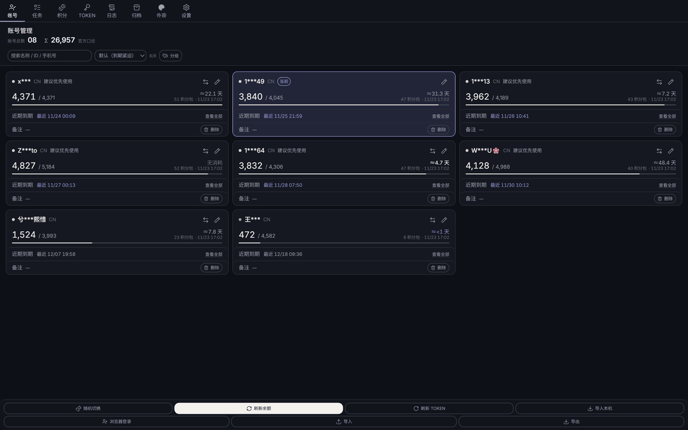

<!-- README_SYNC: source=working-tree; updated=2026-11-23 -->

<p align="center">
  <a href="./README.md">简体中文</a> · English
</p>

<h1 align="center">workbuddy-deck</h1>

<p align="center"><b>A control deck for multiple WorkBuddy accounts — a floating panel injected into the client, covering account switching, check-in, growth tasks, credits, tokens and rate limits on one screen.</b><br/>
For people running several WorkBuddy accounts who click through check-in and growth rewards by hand every day.</p>

<p align="center">
  If it saves you those ten minutes a day, a <a href="https://github.com/a634691481-arch/workbuddy-deck/stargazers"><b>star</b></a> helps you find it again — and helps the next person with the same chore find it too.
</p>

<p align="center">
  <a href="https://a634691481-arch.github.io/workbuddy-deck/"><b>Landing page</b></a> ·
  <a href="https://github.com/a634691481-arch/workbuddy-deck/releases/latest"><b>Download</b></a>
</p>

<p align="center">
  <a href="https://github.com/a634691481-arch/workbuddy-deck/releases/latest"></a>
  <a href="https://github.com/a634691481-arch/workbuddy-deck/stargazers"></a>
  <a href="https://github.com/a634691481-arch/workbuddy-deck/issues"></a>
  <a href="https://github.com/a634691481-arch/workbuddy-deck/commits/main"></a>
  
  
  
  
</p>

<p align="center">
  
</p>

## The manual version, every day

Open the client → switch to account 1 → check in → claim growth rewards → switch to account 2 → repeat. Want to know how much credit is left today? Walk the whole list again.

At three accounts this is tolerable. At eight it is fifteen minutes of mechanical work — and **switching is the risky part**: if the session swap overwrites the previous account's records, what you lose is chat history, not a log line.

This app folds that routine into one deck: check-in and daily tasks run serially across every account and come back classified as success / failed / skipped; balance, expiry and rate limits share one screen; each run leaves an archive entry you can look up later.

## Two shapes, one feature set

| Shape | How it works |
|---|---|
| **Injected panel** (primary) | Launch `WorkBuddy Deck.exe` → it verifies the official client is installed → starts WorkBuddy with `--remote-debugging-port=9222` → connects over CDP and injects a floating icon bottom-right → open the panel without leaving the client |
| **Standalone window** | The same exe also opens a desktop window; `Ctrl+K` jumps between sections — useful on a second monitor or when the panel would cover the chat area |

The installer is built with Inno Setup. The wizard scans the registry for the official client path (editable), then checks whether the client is running and offers to close it. The chosen path lands in `~/.wb-switch/workbuddy_exe.json` and takes priority at runtime.

## Six sections

| Section | What it handles |
|---|---|
| 01 Accounts | QR login / import-export, balance and credit packs, remaining-days forecast, health dot, model rate-limit flags, set-as-current |
| 02 Tasks | Pick accounts → check-in / growth tasks / travel / full daily run, live progress and failure aggregation |
| 03 Credits | Daily spend, per-account balance, model / client / account dimensions; official usage first, local snapshot as fallback |
| 04 Tokens | Multi-source totals, top sessions, call details, week × hour heatmap, 7-day delta |
| 05 Logs | Notification archive + daily automation + error log + switch ledger in one timeline, clearable per source |
| 06 Settings | Version, data directory, data size, display prefs, CSV export, auto-switch on rate limit, per-source log clearing |

## What is actually different

**1. Switching accounts no longer restarts the client — and never touches session content.**
The default is a hot switch: write the auth file, then reassign the whole session pool to the new account with a single `UPDATE user_id`. Same rows, different owner — nothing copied, nothing deleted. Right after the write the app probes the page identity over CDP; if the client did not pick up the new identity it falls back to a restart. A full database backup sits before every reassignment (`~/.wb-switch/backups/reassign-preflight-*`).
The one path that physically deletes a target account's sessions (`replace_sessions=true`) is blocked at the command layer — it caused two real data-loss incidents.

**2. A balance that says how many days are left.**
Instead of just `3,539 / 4,000`, each card shows `≈21.0 days`. The forecast takes the smaller of a median and an EWMA estimate (early warning over optimism) and only counts balance **drops** as consumption — check-in rewards are not negative usage. Below three days of samples it shows "sample 2/3 days" rather than a guess.

**3. Rate limits come with a ledger.**
Not just "429" — which account, which model, the reset time the API reported, how many times it hit. Flags sit on the account card so you can schedule around them. Auto-switch on rate limit is off by default and only advises unless enabled.

**4. Twenty accounts, one glance to spot the dying ones.**
A health dot (green / grey / red) precedes each account name, derived from a readable penalty table: rate limited −35, zero balance −50, under 10% −30, refresh failed −20, forecast exhaustion within 3 days −25. Hover to see the reasons; no black-box score.

**5. Data leaves with you, and the tray keeps watching.**
Four CSVs export from settings (accounts with health and forecast, tokens by day, tokens by model, credit snapshots), UTF-8 BOM so Excel opens them cleanly. The tray icon shows accounts · total balance · the account closest to running dry.

## Quick start

**Install a release**: grab the latest `*_x64-setup.exe` (Windows), `*_aarch64.dmg` (macOS, Apple Silicon) or `*.AppImage` / `*.deb` (Linux) from [Releases](https://github.com/a634691481-arch/workbuddy-deck/releases). The in-app updater picks up later versions.

**Build from source**:

```bash
git clone https://github.com/a634691481-arch/workbuddy-deck.git
cd workbuddy-deck
npm install
npm run tauri build
npm run installer
```

`tauri build` produces the bare exe plus an NSIS installer; `npm run installer` is optional and rebuilds the Inno Setup wizard (requires Inno Setup 6).
Artifacts: bare exe at `src-tauri/target/release/workbuddy-task-assistant.exe`, NSIS under `bundle/nsis/`, Inno under `bundle/innosetup/`.
Requirements: Node.js 18+, stable Rust; WebView2 on Windows 10/11.

**Develop** (HMR for the frontend, no desktop window — just the local bridge and injection):

```bash
npm run deck
```

That is `tauri dev -- --headless`. Don't run two terminals; the port preflight stops the earlier instance.

**UI only** (no backend data):

```bash
npx vite --port 1421
```

Open `http://localhost:1421/`; hash routes jump straight to a section: `#accounts` / `#tasks` / `#credits` / `#tokens` / `#logs` / `#settings`.

## How injection works

```text
Launcher verifies the official client (registry / default dirs)
   → not running: start it with --remote-debugging-port=9222
   → already running: ask to close it, then relaunch with the flag
Local bridge on 127.0.0.1:17653 (panel frontend + IPC)
CDP connects to the WorkBuddy page → registers auto-inject on new documents → injects once
Floating icon appears bottom-right; a 5s liveness probe re-injects after navigation
Clicking the icon opens an iframe panel pointed at 17653
```

No debug port, no injection — which is why "launcher" and "injector" are two jobs of the same exe.

## Auto-update

```text
bump version  →  tag  →  CI build + sign  →  Release  →  client checks  →  verify  →  install  →  restart
```

| Step | Detail |
| --- | --- |
| Version | `npm run bump 0.1.28` syncs `package.json` / `Cargo.toml` / `tauri.conf.json`, failing on mismatch |
| Build | `.github/workflows/release.yml`: three platforms in parallel, signed `.sig` + `latest.json` |
| Check | First check on startup, then on a timer; reads the `latest.json` release asset, not the GitHub API |
| Verify | minisign mismatch aborts the install |
| Mirror | Optional mirror prefix in settings (`https://ghproxy.net/` and similar); empty means direct |

## Architecture

```text
frontend  src/components/ui/*     presentational atoms
          src/components/*        feature components (props / emit only)
          src/composables/*       state and side effects (only layer allowed to call lib/api)
          src/views/*             six sections, each fetches its own data
          src/lib/api.ts          the full IPC contract
backend   src-tauri/src/commands.rs thin command layer: validate + delegate
          src-tauri/src/launcher.rs preflight launcher checks (Windows only)
          src-tauri/src/deck_http/* local bridge: static assets + IPC + panel token
          src-tauri/src/executor.rs batch executor: mutex, progress snapshot, cancel
          src-tauri/src/scheduler.rs daily schedule with catch-up
          src-tauri/src/export.rs four CSV generators
          wb-switch-core crate    accounts / check-in / growth / travel / tokens / switching / forecast / health / CDP
```

Trade-offs:

- **Serial per-account execution**, never concurrent API calls; cancel only takes effect between accounts.
- **Mutex over queue**: one run at a time, duplicates get `busy`.
- **Tokens never leave the backend**: phone numbers and emails are masked in UI and logs.
- **Forecasting reads local snapshots only** — no requests spent on rate-limit and usage estimates.

## Data and privacy

- Everything lives in `~/.wb-switch/` on your machine (accounts, automation config, notification archive, switch history, backups). Nothing is uploaded.
- The app reads and writes those local files and calls official endpoints for check-in / tasks / token refresh. No proxy, no gateway, no session export.
- The only outward-facing action is "set as current account": rewrite auth and reassign the session pool — destructive, confirmed twice, with a full backup first.

## Known limits

- Injection depends on the client's debug port. If an official update changes launch flags or page structure, injection breaks until patched.
- Releases cover three platforms, but macOS ships Apple Silicon only and is ad-hoc signed (not notarized). First launch needs "Open Anyway"; if macOS says the app is damaged, run `sudo xattr -cr "/Applications/WorkBuddy Deck.app"`.
- Auto-update uses GitHub Releases, which can be slow from mainland China; set a mirror prefix.
- 879 unit tests in the core crate and 46 in the command layer; `npm run verify` runs type-check and clippy. CI only builds releases.
- UI copy is Chinese-first; i18n covers Chinese and English, English strings are still being filled in.
- Forecast needs at least three days of snapshots per account; a fresh install shows sample progress only.

## License

There is **no LICENSE file** in this repository yet, so no license is granted. Until one is added, treat it as all rights reserved: reading and learning are fine; commercial use or redistribution should start with an Issue to the author.

## Finally

If this saves you those ten minutes a day, a **star** is welcome. For broken runs, failed check-ins or numbers that look wrong, open an [Issue](https://github.com/a634691481-arch/workbuddy-deck/issues) with account count, the action, and the raw error — far more useful than "doesn't work".
